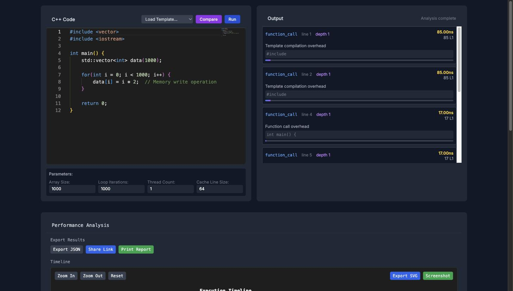

# C++ Performance Analyzer

Write C++ in the browser, run it, and see where the time goes, line by line.



[Open it](https://godofecht.github.io/l1-cache-simulator/)

Each line comes back annotated with the time it cost and its L1 cache cost, and
labelled with the reason: template compilation overhead, function call overhead,
a memory write. The panel below is an execution timeline you can zoom into.

The parameters at the bottom of the editor are the point. Array size, loop
iterations, thread count and cache line size are all adjustable, so the same
loop can be run at 64 byte lines and at 128, or at an array that fits in L1 and
one that does not, and the difference shows up in the annotation rather than
having to be argued about.

`Compare` runs two versions side by side. Results export as JSON, as an SVG of
the timeline, or as a printable report, and `Share Link` puts the whole session
in a URL.

## Run locally

```bash
npm install
npm run dev
```

## Licence

MIT. See [LICENSE](LICENSE).
